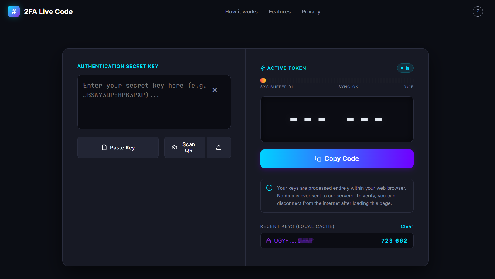

## Hi there 👋

# 2FA Live Code 🔐

A lightweight, front-end-only, and extremely secure online 2FA (TOTP) authenticator web app. 

## 📸 Preview

## ✨ Features

- 🔒 **100% Client-Side**: All calculations are done locally in your browser. Your secret keys are **never** sent to any server.
- ⚡ **Real-time Generation**: Standard TOTP algorithm, automatically refreshing every 30 seconds.
- 📋 **One-Click Copy**: Instantly copy the 6-digit verification code to your clipboard.
- 📷 **QR Code Scanner**: Upload a QR code image or simply paste your secret key.
- 💾 **Local Cache**: Automatically saves your recently used keys in your browser's LocalStorage for quick access.
- 🎨 **Modern UI**: Dark theme with glowing progress bars and a sleek geek aesthetic.

## 🚀 How to Use

1. Visit the live demo: [https://your-username.github.io/](https://your-username.github.io/)
2. Enter your 2FA secret key (e.g., `JBSWY3DPEHPK3PXP`) on the left panel, or click **"Scan QR"** to upload an image.
3. The active token will be generated on the right panel with a countdown timer.
4. Click **"Copy Code"** to copy the 6-digit code.

## 🔒 Privacy & Security

- **No Backend**: This project requires no server-side logic. Everything runs in your browser.
- **Local Storage**: Your keys and codes are processed entirely in memory. The "Recent Keys" are cached securely using your browser's `localStorage`. 
- **Shared Devices**: If you are using a public or shared computer, please click the **"Clear"** button next to "Recent Keys" to wipe your local cache before leaving.

## 🛠️ Local Deployment / Development

This is a single-file HTML project. You can simply clone the repository and double-click `index.html` to open it in your browser. 

*Note: Some browsers may restrict the Web Crypto API (used for generating TOTP) when running via the `file://` protocol. For the best experience, use a local development server (like VS Code's Live Server) or deploy it via GitHub Pages (which provides HTTPS).*

---

*Disclaimer: This tool is for personal use. Please keep your 2FA secret keys safe and never share them with anyone.*

# 2FA Live Code 🔐

一个纯前端、极简风格的 2FA (TOTP) 在线验证码生成工具。

## 📸 界面预览

> 提示：如果是多张图片，可以并排或者换行显示。

## ✨ 功能特性

- 🔒 **绝对安全**：所有计算均在浏览器本地完成，秘钥绝不上传至任何服务器。
- ⚡ **实时生成**：标准 TOTP 算法，每 30 秒自动刷新。
- 📋 **一键复制**：点击按钮即可将 6 位数验证码复制到剪贴板。
- 📷 **扫描二维码**：支持上传二维码截图或直接从剪贴板粘贴秘钥。
- 💾 **本地缓存**：自动在浏览器本地（LocalStorage）保存最近使用的秘钥，打开即用。
- 🎨 **现代 UI**：深色主题，极客风格的进度条与发光特效。

## 🚀 如何使用

1. 直接在浏览器打开：[https://你的用户名.github.io/](https://你的用户名.github.io/) （如果您使用的是项目主页，请加上仓库名，如 `https://你的用户名.github.io/2fa-tool/`）
2. 在左侧输入您的 2FA 秘钥（例如 `JBSWY3DPEHPK3PXP`），或者点击 **"Scan QR"** 上传二维码截图。
3. 右侧会自动生成当前的动态验证码，并显示倒计时进度条。
4. 点击 **"Copy Code"** 复制验证码。

## 🔒 隐私与安全

- 本项目不需要任何后端服务器。
- 秘钥和验证码完全在您的浏览器内存中处理。
- 本地缓存（Recent Keys）仅保存在您当前浏览器的 `localStorage` 中。如果在公共电脑上使用，请点击页面上的 **"Clear"** 按钮清除记录。

## 🛠️ 本地部署 / 开发

由于这是一个单文件 HTML 项目，您只需要克隆仓库，并直接双击打开 `index.html` 即可（部分浏览器可能会因为安全策略限制 `file://` 协议的 Web Crypto API，推荐使用 VS Code 的 Live Server 插件，或者直接部署到 GitHub Pages 上使用）。

---

*Disclaimer: 本项目仅供个人学习和日常使用，请妥善保管您的 2FA 秘钥。*

<!--
**ok2ok22/ok2ok22** is a ✨ _special_ ✨ repository because its `README.md` (this file) appears on your GitHub profile.

Here are some ideas to get you started:

- 🔭 I’m currently working on ...
- 🌱 I’m currently learning ...
- 👯 I’m looking to collaborate on ...
- 🤔 I’m looking for help with ...
- 💬 Ask me about ...
- 📫 How to reach me: ...
- 😄 Pronouns: ...
- ⚡ Fun fact: ...
-->
